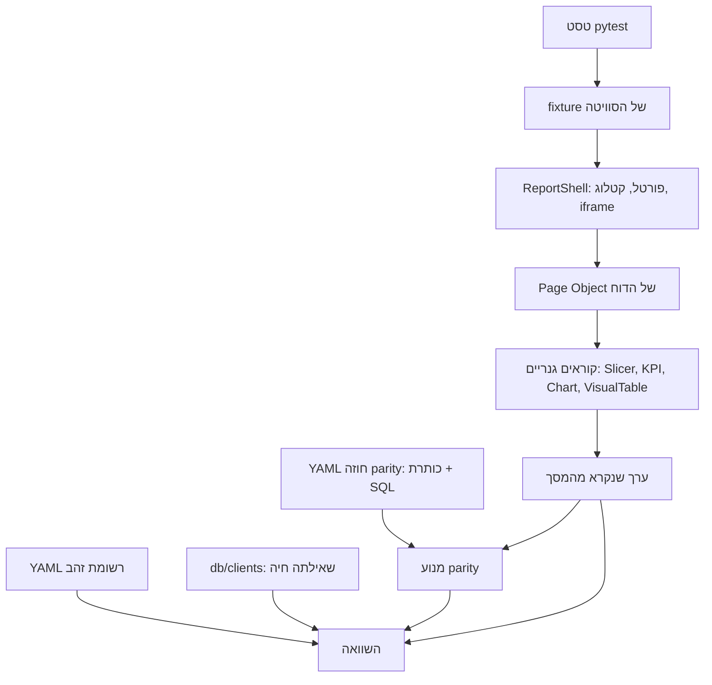

# מדריך הפרויקט — Validation Core

מסגרת בדיקות לדוחות Power BI בפורטל הארגוני.  
היא פותחת דשבורד בדפדפן, קוראת את מה שמוצג על המסך, ומשווה את זה לערך צפוי: רשומת זהב ב-YAML, שאילתה למחסן SQL Server, או יחס פנימי בין ויזואלים באותו מסך.

הקהל: Validation / QA, BI ו-Data.  
המסמך הזה הוא סדר הקריאה. קטלוג המידות של דשבורד הצי נשאר ב-[`COVERAGE_CATALOG.md`](COVERAGE_CATALOG.md). עקרונות השכבות נשארים ב-[`.specify/memory/constitution.md`](../.specify/memory/constitution.md).

---

## שלב 1 — מושגים וספריות

### 1.1 מה נבדק

המוצר הנבדק הוא דוח Power BI שרץ בתוך iframe בפורטל.  
הבדיקה אינה בודקת את קוד הדוח. היא מתנהגת כמו משתמש: נכנסת לפורטל, פותחת מוצר מהקטלוג, ממתינה שהויזואל מוכן, קוראת מספר או תווית, ומשווה.

### 1.2 מילון

| מושג | משמעות בפרויקט |
|------|----------------|
| פורטל | אתר הקטלוג שממנו נפתח כל דוח. כתובת ב-`LOGIN_URL` / `PORTAL_CATALOG_URL`. |
| דשבורד / דוח | מוצר אחד בקטלוג. לכל דוח יש מילת חיפוש (`DASHBOARD_SEARCH_TERM`) ואובייקט עמוד. |
| iframe | המסגרת שבה Power BI מצייר את הדוח. כל קריאה של KPI, גרף או סלייסר מתבצעת בתוכה. |
| Page Object | מחלקה שמרכזת את הניווט והקריאה של דוח אחד. הטסט קורא למתודה, לא ללוקייטור. |
| `ReportShell` | המעטפת המשותפת: התחברות, חיפוש בקטלוג, המתנה ל-iframe, טריות הנתונים. |
| Slicer | בקר סינון של Power BI (רשימה, תיבת סימון, חיפוש). |
| KPI | כרטיס מספר. הכותרת בעברית שייכת לדוח. אופן הקריאה משותף. |
| Gauge | מד עם מינימום ומקסימום. |
| Golden record | קובץ YAML עם מספרים שצולמו לתרחיש קפוא (טווח תאריכים, מבצע, פילטרים). |
| Parity | השוואה חיה: אותו ויזואל מול שאילתת SQL שמגיעה מחוזה YAML. |
| מחסן (warehouse) | SQL Server. מקור האמת כשהבדיקה היא מול נתונים חיים, לא מול צילום. |
| Marker | תגית pytest שמחליטה איזו משפחה של בדיקות רצה: `sanity`, `data`, `regression`, `db_parity`. |
| שכבה (Layer) | גבול בקוד: מה מותר להיות גנרי, ומה חייב להישאר של דוח אחד. |

### 1.3 ספריות

הגרסאות המדויקות ב-[`requirements.txt`](../requirements.txt). Python הנדרש הוא 3.11+.

| ספרייה | תפקיד כאן | תיעוד |
|--------|-----------|--------|
| [pytest](https://docs.pytest.org/) | איסוף בדיקות, fixtures, markers, דיווח כשל | https://docs.pytest.org/en/stable/ |
| [Playwright ל-Python](https://playwright.dev/python/) | Chromium: ניווט, לחיצה, iframe, המתנות, trace וצילום מסך | https://playwright.dev/python/docs/intro |
| [python-dotenv](https://github.com/theskumar/python-dotenv) | טעינת `.env` אל `config/settings.py` | https://saurabh-kumar.com/python-dotenv/ |
| [PyYAML](https://pyyaml.org/) | קריאת חוזי הבדיקה ורשומות הזהב | https://pyyaml.org/wiki/PyYAMLDocumentation |
| [SQLAlchemy](https://docs.sqlalchemy.org/) 2 | מנוע חיבור ומחרוזות שאילתה לקריאה בלבד | https://docs.sqlalchemy.org/en/20/ |
| [pyodbc](https://github.com/mkleehammer/pyodbc/wiki) | גשר ODBC אל SQL Server עם `Trusted_Connection` | https://github.com/mkleehammer/pyodbc/wiki |
| [pandas](https://pandas.pydata.org/docs/) ו-[openpyxl](https://openpyxl.readthedocs.io/) | קריאה של קובצי ה-Excel הגולמיים תחת `data/raw/` | https://pandas.pydata.org/docs/ |
| [pytest-html](https://pytest-html.readthedocs.io/) | דוח HTML תחת `result/html-reports/` | https://pytest-html.readthedocs.io/ |
| [pytest-reportportal](https://github.com/reportportal/agent-python-pytest) | דיווח אופציונלי. כבוי כברירת מחדל. מופעל עם `pytest --reportportal` | https://reportportal.io/docs |

הדפדפן עצמו מותקן בנפרד: `playwright install chromium`.  
תיעוד Power BI (המוצר הנבדק, לא ספרייה שלנו): https://learn.microsoft.com/power-bi/

`greenlet` נעול בגרסה כי Playwright תלוי בו. אין לקרוא לו מהבדיקות.

### 1.4 שלושה סוגי "אמת" שהבדיקה יכולה להחזיק

1. **המסך עצמו** — הטריות של הכיתוב "הדשבורד עודכן לאחרונה ב:", או יחס בין שני ויזואלים (יום + לילה = הסכום בלי המתג).
2. **רשומת זהב** — מספרים שנשמרו ב-YAML לתרחיש ידוע. השינוי במחסן אחרי צילום הרשומה ישבור את הבדיקה בכוונה, עד שמעדכנים את הקובץ.
3. **המחסן החי** — שאילתת `SELECT` על הטבלאות. הערך ב-UI חייב להתאים לתוצאת השאילתה בזמן הריצה.

---

## שלב 2 — איך בדיקה גנרית פוגשת דשבורד ו-YAML

הקוד הגנרי לא מכיר "רכבים", "התרעות" או "אשראי".  
הוא יודע לפתוח פורטל, לחפש מחרוזת שקיבל, לקרוא מספר ליד כותרת שקיבל, ולהשוות.  
השם של הדוח, הכותרות בעברית, הפילטרים והמספרים הצפויים מגיעים מבחוץ.



### 2.1 מה גנרי ומה של הדוח

| שאלה | מי עונה | איפה |
|------|---------|------|
| איך מתחברים לפורטל ושומרים סשן? | גנרי | `browser_session`, `core/portal/page.py` |
| איזה מוצר לחפש בקטלוג? | הדוח | `DASHBOARD_SEARCH_TERM` על מחלקת העמוד. בצי: `DASHBOARD_SEARCH_TERM` ב-`.env`, ברירת מחדל `שליטה בניוד` |
| מתי הדוח נחשב טעון? | הדוח | `_report_ready_locator()` |
| איך לוחצים על סלייסר? | גנרי | `core/components/slicer.py` |
| איזה סלייסר, ואיזו תווית לבחור? | הדוח | `SlicerDefinition` בעמוד, או ערכים ב-YAML / JSON |
| איך קוראים מספר מכרטיס? | גנרי | `core/components/kpi.py` |
| מה כותרת הכרטיס? | הדוח או ה-YAML | למשל `סה"כ רכבים בשימוש` |
| איך פותחים "הצג כטבלה"? | גנרי | `core/components/visual_table.py` |
| איזה גרף, ואיזו שורת סיכום לדלג? | הדוח | `read_chart_segments` בצי, עם האסימון `סה"כ` |
| מה המספר הנכון? | החוזה | YAML, או SQL ב-`db/clients/` |

אחרי שינוי בקורא גנרי, שער העשן של הצי (`tests/ui/fleet_dashboard/`) חייב לעבור. זה החוזה של השכבה המשותפת.

### 2.2 חמש משפחות בדיקה

**א. טריות (כמעט כל הדשבורדים)**  
הטסט הוא שורה אחת: `dashboard.verify_freshness()`.  
`ReportShell` מחפש ב-iframe את הכיתוב הגנרי `הדשבורד עודכן לאחרונה ב:` ובודק שהחותמת בתוך 24 שעות. אין YAML ואין SQL.

**ב. רשומת זהב — UI מול YAML**  
הטסט טוען YAML, מפעיל על המסך את אותו תרחיש (מבצע, טווח תאריכים, פילטרים), קורא דרך ה-Page Object, ומשווה מפתח מפתח.

| קובץ | תרחיש קפוא | מי צורך אותו |
|------|------------|--------------|
| `data/fleet/db_sanity_all.yaml` | תמונת צי: סיכום, פילוח יחידות, מקור משיכה, קטגוריות, סיבות זיכוי, שורות כרטסת | `tests/sanity/fleet_dashboard/` |
| `data/alerts/db_sanity_am_kalavi.yaml` | מבצע "עם כלביא" במסך תמונת מצב, וטווח תאריכים במסך אוכלוסייה | `tests/sanity/status_picture_dashboard/`, `tests/sanity/alerts_analysis_dashboard/` |
| `data/credit/db_sanity_purim2026.yaml` | פורים 2026: KPI, מגמות, התרעות יומיות, טבלת ייצוא | `tests/sanity/credit_consumption_dashboard/` |
| `data/hasbara/db_sanity.yaml` | פניות הסברה, מענה כתוב, אוקטובר 2026 | הקובץ קיים. אין עדיין סוויטת טסטים שקוראת אותו |

דוגמה מהצי. ה-YAML מחזיק את המספרים. הטסט לא ממציא אותם:

```yaml
summary:
  total_vehicles_in_use: 358
  total_vehicles_received: 363
units_breakdown:
  מחוז צפון: 71
```

הטסט של הגרף קורא את הוויזואל דרך "הצג כטבלה" ומשווה כל תווית לערך בקובץ. אם הגרף לא חשף אף תווית מהרשומה, הבדיקה מדווחת `skip`. ערך גלוי שגוי הוא כשל.

**ג. Parity — YAML עם SQL, קוראים גנריים**  
`data/alerts/alerts_contract.yaml` אינו רשימת מספרים. כל מדד הוא:

- `name` — כותרת הוויזואל על המסך
- `visual` — `kpi`, `gauge`, `chart` או `map`
- `sql_query` — השאילתה, עם `:start_date`, `:end_date`, ולפעמים `:category_id`
- `scope` — כשיש שתי כותרות זהות במסכים שונים

`tests/helpers/db_parity_engine.py` (`validate_dashboard_generic`) טוען את הרשימה, קורא את המסך עם `KPI` ו-`Chart`, מריץ את ה-SQL דרך לקוח שמספק `scalar` / `rows` / `cell`, ונכשל על פער.  
המנוע לא יודע שזו התרעה. הכותרת וה-SQL נשארים בקובץ.  
הטסט `tests/ui/alerts_analysis_dashboard/test_db_parity.py` מסומן `db_parity` וכרגע מדולג (`skip`), כדי שהמיקוד יישאר על רשומת הזהב.

**ד. מחסן חי בלי YAML של מספרים — הצי**  
`tests/e2e/` משווה KPI, טבלה, גרפים וטולטיפים אל `db/clients/fleet.py`.  
הפילטרים שמפעילים את התרחיש יושבים ב-`data/fleet/filters.json` וב-`data/fleet/filter_matrix.json`.  
המיפוי העסקי KPI ↔ טבלה ↔ טסט מתועד ב-[`COVERAGE_CATALOG.md`](COVERAGE_CATALOG.md).

**ה. אינווריאנטים על המסך**  
`tests/ui/alerts_analysis_dashboard/test_population_invariants.py` לא פונה ל-YAML ולמחסן.  
הוא בודק שהמסך עקבי עם עצמו: ניקוי פילטרים מחזיר את התמונה, וסכום שעות היום והלילה שווה לגרף בלי המתג.

### 2.3 מה קורה בפועל בריצה אחת של רשומת זהב

1. pytest מעלה Chromium ומשחזר `auth_state.json`, או מחכה להתחברות ידנית.
2. ה-fixture בונה את מחלקת העמוד וקורא ל-`navigate`.
3. `ReportShell` פותח את הקטלוג, מחפש את מילת הדוח, נכנס ל-iframe, ומחכה ללוקייטור המוכנות של אותו דוח.
4. הטסט קורא YAML עם `yaml.safe_load`.
5. מתודות העמוד מפעילות את הפילטרים שכתובים ברשומה.
6. מתודות העמוד קוראות כרטיסים וגרפים. הן מרכיבות קוראים גנריים ומעבירות להם כותרות של הדוח.
7. הטסט משווה. פער נכתב כ-`ui=... golden=...`.
8. בסוף הריצה נשמרים HTML, CSV בעברית, ובכשל גם צילום מסך.

---

## שלב 3 — ארכיטקטורה

החלוקה נועדה לאפשר דוח חדש בלי להעתיק התחברות, iframe וסלייסרים, ובלי לשתול מילה של דוח אחד בתוך הקוד המשותף.

```text
בדיקה (tests/)
    קוראת למתודות של אובייקט עמוד
        pages/<דוח>/          שכבת הדוח
            יורשת ReportShell
            מרכיבה Slicer / KPI / Chart / VisualTable
                core/portal/          שכבה 0 — מעטפת הפורטל
                core/components/      שכבה 2 — קוראי ויזואל
        data/<דוח>/           שכבה 3 — חוזים וקטלוגים
        db/clients/<דוח>.py   מחסן, קריאה בלבד
        db/connection.py      מפעל חיבור גנרי
```

יורשים: `BasePage` (timeout ו-retry) → `ReportShell` → עמוד הדוח.  
`Slicer` הוא רכיב שמרכיבים, לא מחלקת בסיס.

### 3.1 שכבה 0 — `core/portal/page.py`

`ReportShell` מחזיק רק התנהגות של כל דוח Power BI בפורטל:

- כניסה ו-SSO
- חיפוש בקטלוג לפי המחרוזת שהעמוד מספק
- המתנה ל-iframe ולטעינת ויזואל
- כיתוב הטריות
- נקודת הרחבה `_bypass_secondary_auth` — ברירת המחדל ריקה. דוחות ArcGIS מממשים אותה ב-`pages/secondary_auth.py`, מחוץ ל-`core/`

העמוד של הדוח חייב לממש `_report_ready_locator`. בלי זה אי אפשר לדעת שהדוח הנכון עלה.

### 3.2 שכבת הדוח — `pages/<report>/`

כאן מותרות כותרות, שמות סלייסרים, טאבים, טולטיפים ו-drill-down.  
הטסטים מייבאים את המחלקה. אסור להגדיר אובייקט עמוד בתוך `tests/`.

הקבצים המרכזיים:

| דוח | מחלקה | קובץ |
|-----|--------|------|
| צי | `MainDashboardPage` | `pages/fleet_dashboard/main_dashboard_page.py` |
| התרעות | `AlertsAnalysisPage` | `pages/alerts_analysis/page.py` |
| אוכלוסייה (עמוד 2 של התרעות) | `AlertsPopulationPage` | `pages/alerts_analysis/population_page.py` |
| תמונת מצב (עמוד 1 של התרעות) | `StatusPicturePage` | `pages/status_picture/status_picture_page.py` |
| צריכת אשראי | `CreditConsumptionPage` | `pages/credit_consumption/credit_consumption_page.py` |
| שאר המוצרים | מחלקה דקה על `ReportShell` | `pages/<שם>/page.py` |

### 3.3 שכבה 2 — `core/components/`

| מודול | יודע | לא יודע |
|-------|------|---------|
| `slicer.py` | dropdown, checkbox, search, "נקה את כל" | שמות עסקיים של פילטרים |
| `kpi.py` | איתור כרטיס לפי כותרת, נרמול מספר, סקאלת gauge | שמות KPI |
| `chart.py` | סדר קטגוריות, סימני data, מקרא | טולטיפ ו-drill-down |
| `visual.py` | scope, ריק מול אפס, ספירת סימנים | שמות דוחות |
| `visual_table.py` | קליק ימני, "הצג כטבלה" / "Show as a table", קריאת גריד, "חזרה לדוח" | כותרת גרף של הצי, אסימון `סה"כ` |

### 3.4 שכבה 3 — `data/<report>/`

`core/` לא קורא את הקבצים האלה.

| נתיב | תוכן |
|------|------|
| `data/fleet/db_sanity_all.yaml` | רשומת זהב של הצי |
| `data/fleet/filters.json` | ערכי סלייסר לתרחישים |
| `data/fleet/filter_matrix.json` | צירופי סינון לרגרסיה |
| `data/alerts/db_sanity_am_kalavi.yaml` | רשומת זהב של שני מסכי ההתרעות |
| `data/alerts/alerts_contract.yaml` | חוזה parity: כותרת + SQL |
| `data/credit/db_sanity_purim2026.yaml` | רשומת זהב פורים 2026 |
| `data/hasbara/db_sanity.yaml` | רשומת זהב להסברה, בלי סוויטה עדיין |
| `data/raw/*.xlsx` | ייצוא גולמי של טבלאות הצי |

### 3.5 מחסן — `db/`

`db/connection.py` בונה מחרוזת `mssql+pyodbc` עם `Trusted_Connection`. הוא לא מכיל SQL עסקי.  
`db/clients/fleet.py` ו-`db/clients/alerts.py` הם קריאה בלבד, קובץ לכל דוח.  
`core/` לא מייבא את `db.clients`. ה-`conftest` בשורש לא מייבא עמוד של דוח ולא לקוח SQL, כדי שאיסוף בדיקות של דוח אחד לא יטען דוח אחר.

### 3.6 בדיקות ועוזרים

| נתיב | תפקיד |
|------|--------|
| `tests/conftest.py` | דפדפן, סשן, התחברות, דוח ריצה |
| `tests/helpers/dashboard_fixture.py` | `bind_dashboard` — פותח את מחלקת העמוד על הטאב המשותף |
| `tests/helpers/db_parity_engine.py` | המנוע הגנרי של חוזה ה-YAML |
| `tests/ui/<דוח>/` | עשן, פילטרים, אינווריאנטים |
| `tests/sanity/<דוח>/` | רשומת זהב |
| `tests/e2e/` | רגרסיית הצי מול המחסן |
| `tests/unit/` | פונקציות טהורות בלי דפדפן |
| `reports/test_run_report.py` | CSV בעברית: שם, סטטוס, משך, פעולה, שאילתה, פלט |

### 3.7 כללי גבול שכדאי לזכור

- מילה של דוח אחד בתוך `core/` נפסלת. הדוח הבא לא יוכל להשתמש בשכבה.
- טסט מפעיל את הדפדפן דרך אובייקט העמוד.
- שינוי בשכבה 0 או 2 נמדד מול עשן הצי.
- שאילתה עסקית נשארת ב-`db/clients/` ונשארת `SELECT`.

---

## שלב 4 — איך מריצים

התקנה, משתני סביבה והתחברות מפורטים ב-[`README.md`](../README.md). התמצית:

1. `MANUAL_LOGIN=true` בפעם הראשונה. נפתח דפדפן, מתחברים לפורטל, והסשן נשמר ב-`auth_state.json`.
2. אחר כך `MANUAL_LOGIN=false` משחזר את הסשן.
3. חיבור ה-SQL הוא זהות Windows דרך ODBC Driver 17.

| פקודה | מה רץ |
|-------|--------|
| `pytest -m sanity` | עשן וטריות, ורשומות זהב שמסומנות `sanity` |
| `pytest -m data` | בדיקות הצי מול המחסן |
| `pytest -m regression` | רגרסיית הצי: KPI, פילטרים, טבלאות, גרפים |
| `pytest -m db_parity` | חוזה ה-SQL הגנרי. כרגע מדולג |
| `pytest tests/ui/fleet_dashboard/` | שער אחרי שינוי בשכבה המשותפת |
| `pytest --reportportal` | אותו ריצה, עם דיווח ל-ReportPortal אם המפתח הוגדר |

אחרי ריצה, תחת `result/` (לא ב-git): HTML, CSV בעברית, צילומי מסך, ו-trace כשהמעקב דולק.

---

## שלב 5 — הדשבורדים הקיימים

כל השורות נפתחות מאותו פורטל דרך `ReportShell`.  
עומק הבדיקה שונה: חלקם רק "הדוח עלה והנתונים טריים", וחלקם משווים כל ויזואל לרשומה או למחסן.

### 5.1 כיסוי מלא או חלקי

**שליטה בניוד** — מילת קטלוג `שליטה בניוד` (מ-`.env`).  
עמוד: `MainDashboardPage`.  
ארבעה KPI: סה"כ רכבים שנקלטו, סה"כ רכבים בשימוש, רכבים שזוכו, רכבים שווסתו.  
ארבעה גרפים: מקור משיכה, יחידות, קטגוריות, סיבות זיכוי. טאבים וטבלת רכבים.  
בדיקות: עשן ו-SLA טעינה, UX של סלייסרים, רגרסיה מול SQL (`tests/e2e/`), רשומת זהב (`data/fleet/db_sanity_all.yaml`).  
המחסן: `[DIM].[Vehicle]`, `[FACT].[SigningReturnVehicle]`, `[FACT].[VehicleFlow]` דרך `db/clients/fleet.py`.  
פירוט המידות: [`COVERAGE_CATALOG.md`](COVERAGE_CATALOG.md).

**ניתוח התרעות** — מילת קטלוג `ניתוח התרעות`. מוצר אחד, שני מסכים.

| מסך | מחלקה | מה נבדק מול הרשומה |
|-----|--------|---------------------|
| תמונת מצב, נחיתה | `StatusPicturePage` | אזורי התרעה, אוכלוסייה, סוגי התרעות, עשרת היישובים. בחירת מבצע "עם כלביא" |
| ניתוח אוכלוסייה, עמוד 2 | `AlertsPopulationPage` | כרטיסי אוכלוסייה, יישובים, היררכיה, גרפי תאריך ושעה |

בנוסף: עשן טריות, אינווריאנטים על עמוד 2, וחוזה parity ב-`data/alerts/alerts_contract.yaml` (ההרצה מדולגת).  
לקוח SQL: `db/clients/alerts.py`, בסיס `DB_ALERTS_NAME`.

**צריכת אשראי** — מילת קטלוג `צריכת אשראי`.  
עמוד: `CreditConsumptionPage`. סוגר חלון "דף מידע" אם הוא מופיע.  
שני מסכים ברשומה `data/credit/db_sanity_purim2026.yaml`: סיכום (KPI, מגמות לפי מתג, התרעות יומיות) וייצוא נתונים.  
יש גם עשן טריות. אין עדיין לקוח SQL ייעודי במחסן.

### 5.2 עשן טריות בלבד

הטסט בכל אחד מהם: `test_dashboard_updated_within_24_hours` קורא ל-`verify_freshness()`.  
אובייקט העמוד מחזיק מילת קטלוג ולוקייטור מוכנות, בלי סלייסרים ובלי רשומת זהב מחוברת.

| מוצר בקטלוג | מחלקה | הערה |
|-------------|--------|------|
| תמונת מצב הפסקות חשמל | `PowerOutagesPage` | מוכנות לפי "לקוחות חיוניים מופסקים" |
| מרס"ל | `MarsalPage` | |
| הערכת מצב רשויות | `AuthoritiesStatusPage` | |
| תמ"צ חוסן | `HosenStatusPage` | |
| כשירויות חילוץ במרחב האזרחי | `RescueCapabilitiesPage` | |
| ניתוח פניות הסברה | `PublicInquiriesPage` | רשומת הזהב של ההסברה כבר ב-`data/hasbara/db_sanity.yaml`, בלי טסטים |
| תמ"צ אירועים המוניים | `MassEventsPage` | אחרי הקטלוג: מסך כניסה משני (ArcGIS) |
| תמ"צ שליטה - סטטוס הנחיות מצילות חיים | `LifeSavingGuidelinesPage` | אותו מסך כניסה משני |
| מערכת המא"יה | `MayaSystemPage` | אותו מסך כניסה משני |
| תמ"צ מחסים ציבוריים | `PublicSheltersPage` | אותו מסך כניסה משני |

מסך הכניסה המשותף יושב ב-`pages/secondary_auth.py`. `ReportShell` רק קורא ל-hook. מימוש הלחיצות נשאר מחוץ ל-`core/`.

### 5.3 עומק במבט אחד

| עומק | דשבורדים |
|------|----------|
| פורטל + מחסן חי + רשומת זהב + עשן | שליטה בניוד |
| שני מסכים + רשומת זהב + אינווריאנטים + חוזה SQL מדולג | ניתוח התרעות |
| שני מסכים + רשומת זהב + עשן | צריכת אשראי |
| הדוח נפתח והכיתוב טרי | שאר עשרת המוצרים |
| קובץ מספרים בלי סוויטה | הסברה (`data/hasbara/`) |

---

## שלב 6 — לאן הולכים כשמוסיפים כיסוי

הסדר שהפרויקט כבר מיישם, מהדק אל העמוק:

1. **חיבור לשכבה 0.** מחלקה ב-`pages/<דוח>/` שיורשת `ReportShell`, עם מילת קטלוג ולוקייטור מוכנות. סוויטת עשן שקוראת ל-`verify_freshness()`.
2. **קריאה מהמסך.** מתודות על העמוד. סלייסר דרך `Slicer`. כרטיס דרך `KPI`. גרף דרך `Chart` או `VisualTable`. הכותרות נשארות בעמוד.
3. **רשומת זהב.** YAML תחת `data/<דוח>/` עם התרחיש (תאריכים, פילטרים, מספרים). טסט תחת `tests/sanity/` שמפעיל את התרחיש ומשווה.
4. **מחסן חי.** קובץ ב-`db/clients/<דוח>.py`, או חוזה `metrics` עם `name` + `sql_query` אם הוויזואלים מתאימים למנוע ה-parity.
5. **קטלוג.** כשמידה או סלייסר משתנים, מעדכנים את עמוד הדוח, את ה-SQL ואת מסמך הכיסוי של אותו דוח.

דוח חדש לא מעתיק את מסלול ההתחברות. הוא מממש את שתי הנקודות שהמעטפת משאירה לו: מה לחפש בקטלוג, ומה אומר שהדוח עלה.
